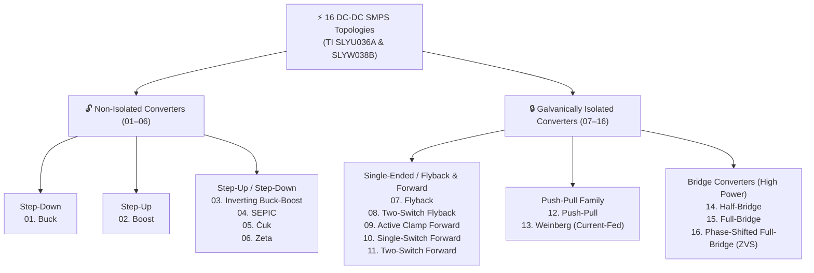

<div align="center">


<br/>

[](#)
[](#)
[](#)
[_%7C_Calc_(.ods)-16a34a?style=for-the-badge)](#)

<br/>

### 🌐 [**🇬🇧 English Documentation**](#-english-documentation) &nbsp;&nbsp;|&nbsp;&nbsp; [**🇹🇷 Türkçe Dokümantasyon**](#-türkçe-dokümantasyon)

</div>

---

<a id="-english-documentation"></a>

# 🇬🇧 Power Electronics — 16 SMPS Topologies Design & Live Formula Suite

> **An end-to-end interactive engineering design toolkit for 16 fundamental Switched-Mode Power Supply (SMPS) DC-DC topologies**, built upon the **Texas Instruments *Power Topologies Handbook* (SLYU036A)** and **TI *Power Topologies Quick Reference Guide* (SLYW038B)**.

---

## ✨ Key Highlights

| Feature | Description |
| :--- | :--- |
| 🖥️ **100% Offline Interactive Web Studios** | Zero dependencies or internet required. Modify any of the **14 input design parameters** and watch **400 engineering equations** update in real time across 16 topologies. |
| 📐 **Embedded Schematics & MathML/LaTeX** | Includes all 16 original TI SLYU036A converter schematics, the full SLYW038B comparison poster, rendered MathML equations, and one-click **LaTeX / Unicode** equation copying. |
| 📊 **Native Spreadsheet Engines (`.xlsx` & `.ods`)** | 16 dedicated topology worksheets containing 400 live spreadsheet formulas with automatic unit scaling, ready for Microsoft Excel and LibreOffice Calc. |
| 💾 **State Persistence & JSON Export** | Save custom converter designs per topology directly in browser `localStorage`, reset to reference defaults at any time, or export full input/output snapshots as `.json`. |
| ✅ **Cross-Verified Calculation Core** | Every JavaScript formula in the HTML calculators has been numerically verified 1-to-1 against the master Excel/ODS engineering workbooks. |

---

## 🧭 Topology Selection & Classification Architecture



---

## 📁 Repository File Structure

| File | Format | Purpose & Capabilities |
| :--- | :---: | :--- |
| **[`TI_16_Canli_Hesaplayici.html`](./TI_16_Canli_Hesaplayici.html)** | `HTML5 / JS` | **Flagship Interactive Design Studio:** Embedded TI schematics, high-res topology comparison poster, offline MathML formulas, `localStorage` persistence, and JSON export. |
| **[`TI_16_Guc_Kaynagi_Topolojisi_Interaktif_Tablo.html`](./TI_16_Guc_Kaynagi_Topolojisi_Interaktif_Tablo.html)** | `HTML5 / JS` | **Fast Interactive Table & LaTeX Studio:** Lightweight calculator with instant one-click LaTeX & Unicode formula copy for papers and technical reports. |
| **[`TI_16_Guc_Kaynagi_Topolojisi_Tasarim_ve_Formul_Hesaplayici.xlsx`](./TI_16_Guc_Kaynagi_Topolojisi_Tasarim_ve_Formul_Hesaplayici.xlsx)** | `Excel (.xlsx)` | **Master Engineering Workbook:** 16 topology tabs with 400 active Excel formulas, input cells (`B5:B18`), and automated stress/thermal calculations. |
| **[`TI_16_Guc_Kaynagi_Topolojisi_Tasarim_ve_Formul_Hesaplayici.ods`](./TI_16_Guc_Kaynagi_Topolojisi_Tasarim_ve_Formul_Hesaplayici.ods)** | `Calc (.ods)` | **LibreOffice / OpenDocument Workbook:** Full open-source office suite compatibility with identical live formula structure. |
| **[`TI_16_HTML_Kontrol_Notlari.md`](./TI_16_HTML_Kontrol_Notlari.md)** | `Markdown` | **Verification & Engineering Notes:** Documents the 1-to-1 parity tests between the Excel workbook and JavaScript engine, plus modeling assumptions. |

---

## 🔌 Covered 16 SMPS Topologies

<table>
<thead>
<tr>
<th>#</th>
<th>Topology</th>
<th>Isolation</th>
<th>Conversion Type</th>
<th>Typical Power &amp; Key Engineering Trait</th>
<th>TI Ref</th>
</tr>
</thead>
<tbody>
<tr>
<td><b>01</b></td>
<td><b>Buck Converter</b></td>
<td>Non-Isolated</td>
<td>Step-Down ($V_{out} &lt; V_{in}$)</td>
<td>Continuous output current, low output ripple, no RHPZ</td>
<td>Ch. 3</td>
</tr>
<tr>
<td><b>02</b></td>
<td><b>Boost Converter</b></td>
<td>Non-Isolated</td>
<td>Step-Up ($V_{out} &gt; V_{in}$)</td>
<td>Continuous input current, pulsating diode current, exhibits RHPZ</td>
<td>Ch. 4</td>
</tr>
<tr>
<td><b>03</b></td>
<td><b>Inverting Buck-Boost</b></td>
<td>Non-Isolated</td>
<td>Step-Up/Down ($-V_{out}$)</td>
<td>Negative output polarity, single inductor, exhibits RHPZ</td>
<td>Ch. 5</td>
</tr>
<tr>
<td><b>04</b></td>
<td><b>SEPIC Converter</b></td>
<td>Non-Isolated</td>
<td>Step-Up/Down ($+V_{out}$)</td>
<td>Non-inverting output, series coupling capacitor provides DC blocking</td>
<td>Ch. 6</td>
</tr>
<tr>
<td><b>05</b></td>
<td><b>Ćuk Converter</b></td>
<td>Non-Isolated</td>
<td>Step-Up/Down ($-V_{out}$)</td>
<td>Continuous input &amp; output currents, capacitive energy transfer</td>
<td>Ch. 7</td>
</tr>
<tr>
<td><b>06</b></td>
<td><b>Zeta Converter</b></td>
<td>Non-Isolated</td>
<td>Step-Up/Down ($+V_{out}$)</td>
<td>Non-inverting buck-boost with continuous output current &amp; <b>no RHPZ</b></td>
<td>Ch. 8</td>
</tr>
<tr>
<td><b>07</b></td>
<td><b>Flyback Converter</b></td>
<td>Isolated</td>
<td>Step-Up/Down</td>
<td>&lt; 100 W; coupled inductor stores energy, minimal component count</td>
<td>Ch. 9</td>
</tr>
<tr>
<td><b>08</b></td>
<td><b>Two-Switch Flyback</b></td>
<td>Isolated</td>
<td>Step-Up/Down</td>
<td>MOSFET voltage stress clamped to $V_{in,max}$; leakage energy recycled</td>
<td>Ch. 10</td>
</tr>
<tr>
<td><b>09</b></td>
<td><b>Active Clamp Forward</b></td>
<td>Isolated</td>
<td>Step-Down Derived</td>
<td>Active reset allows $D &gt; 0.5$, reduced switch voltage stress</td>
<td>Ch. 11</td>
</tr>
<tr>
<td><b>10</b></td>
<td><b>Single-Switch Forward</b></td>
<td>Isolated</td>
<td>Step-Down Derived</td>
<td>100–300 W; third reset winding limits duty cycle ($D_{max} &lt; 0.5$)</td>
<td>Ch. 12</td>
</tr>
<tr>
<td><b>11</b></td>
<td><b>Two-Switch Forward</b></td>
<td>Isolated</td>
<td>Step-Down Derived</td>
<td>Switches clamped to $V_{in,max}$, high reliability for industrial supplies</td>
<td>Ch. 13</td>
</tr>
<tr>
<td><b>12</b></td>
<td><b>Push-Pull Converter</b></td>
<td>Isolated</td>
<td>Step-Down Derived</td>
<td>Bidirectional core excitation, low primary conduction loss</td>
<td>Ch. 14</td>
</tr>
<tr>
<td><b>13</b></td>
<td><b>Weinberg Converter</b></td>
<td>Isolated</td>
<td>Current-Fed Push-Pull</td>
<td>Aerospace &amp; satellite power buses; inherent overcurrent protection</td>
<td>Ch. 15</td>
</tr>
<tr>
<td><b>14</b></td>
<td><b>Half-Bridge Converter</b></td>
<td>Isolated</td>
<td>Step-Down Derived</td>
<td>200–500 W; switch voltage stress limited to $V_{in,max}$</td>
<td>Ch. 16</td>
</tr>
<tr>
<td><b>15</b></td>
<td><b>Full-Bridge Converter</b></td>
<td>Isolated</td>
<td>Step-Down Derived</td>
<td>&gt; 500 W; maximum transformer utilization, low primary switch stress</td>
<td>Ch. 17</td>
</tr>
<tr>
<td><b>16</b></td>
<td><b>Phase-Shifted Full-Bridge (PSFB)</b></td>
<td>Isolated</td>
<td>ZVS Full-Bridge</td>
<td>High-power (&gt; 1 kW) Zero-Voltage Switching (ZVS) for high efficiency</td>
<td>Ch. 18</td>
</tr>
</tbody>
</table>

---

## 🧮 Mathematical & Engineering Calculation Matrix (14 Inputs → 25 Outputs)

For every topology, entering **14 standard design specifications** ($V_{in,nom}$, $V_{in,min}$, $V_{in,max}$, $V_{out}$, $I_{out}$, $f_{sw}$, $\Delta I_L\%$, $\Delta V_{out}\%$, $V_f$, $\eta$, turns ratio $n = N_p/N_s$, $R_{DS(on)}$, $B_{max}$, $J_{max}$) automatically computes **25 critical engineering outputs**:

1. **Operating Point & Duty Cycle:** Output/input power ($P_{out}, P_{in}$) and nominal/extreme duty ratios ($D_{nom}, D_{max}, D_{min}$).
2. **Magnetics Sizing:** Minimum inductance ($L_{min}$), magnetizing inductance ($L_m$), and CCM/DCM boundary critical inductance ($L_{crit}$).
3. **Semiconductor Stress Analysis:** Inductor, MOSFET, and diode peak ($I_{peak}$), average ($I_{avg}$), and RMS ($I_{rms}$) currents; maximum blocking voltages ($V_{DS,max}, V_{R,max}$).
4. **Capacitor Selection Criteria:** Minimum output/coupling capacitance ($C_{min}$), maximum allowable Equivalent Series Resistance ($ESR_{max}$), and capacitor RMS ripple current ($I_{C,rms}$).
5. **Core & Conductor Geometry:** Magnetic Core Area-Product ($A_p = A_e \cdot A_w$ in $\text{cm}^4$) and copper wire cross-sectional area ($A_{wire}$ in $\text{mm}^2$).
6. **Control Loop & Stability:** Output $LC$ filter resonant frequency ($f_{LC}$), Right-Half-Plane Zero frequency ($f_{RHPZ}$), and recommended maximum crossover bandwidth ($f_{c,max}$).
7. **Thermal & Loss Budget:** MOSFET conduction ($P_{cond}$) and switching ($P_{sw}$) losses, diode conduction loss ($P_D$), total power dissipation ($P_{loss}$), and estimated junction temperature rise ($\Delta T_J$).

---

## 🚀 Quick Start

```bash
# 1. Clone the repository
git clone git@github.com:rasittaflan/Power_Electronics.git
cd Power_Electronics

# 2. Launch the Interactive Design Studio in your default browser (Linux/macOS/Windows)
xdg-open TI_16_Canli_Hesaplayici.html
```

- **Zero Installation:** Simply double-click [`TI_16_Canli_Hesaplayici.html`](./TI_16_Canli_Hesaplayici.html) or [`TI_16_Guc_Kaynagi_Topolojisi_Interaktif_Tablo.html`](./TI_16_Guc_Kaynagi_Topolojisi_Interaktif_Tablo.html) to open in any modern web browser.
- **Spreadsheet Workflow:** Open the [`.xlsx`](./TI_16_Guc_Kaynagi_Topolojisi_Tasarim_ve_Formul_Hesaplayici.xlsx) or [`.ods`](./TI_16_Guc_Kaynagi_Topolojisi_Tasarim_ve_Formul_Hesaplayici.ods) file and edit the yellow input cells (`B5:B18`) on any topology sheet.

---
---

<a id="-türkçe-dokümantasyon"></a>

# 🇹🇷 Güç Elektroniği — 16 Anahtarlamalı Güç Kaynağı (SMPS) Topolojisi Tasarım ve Hesaplama Paketi

> **Texas Instruments (TI) *Power Topologies Handbook* (SLYU036A)** ve **TI *Power Topologies Quick Reference Guide* (SLYW038B)** referans dokümanları temel alınarak geliştirilmiş; **16 temel DC-DC anahtarlamalı güç kaynağı (SMPS) topolojisi** için uçtan uca devre elemanı boyutlandırma, stres analizi, manyetik nüve seçimi, kontrol döngüsü kararlılığı ve termal kayıp hesaplamalarını içeren interaktif mühendislik araç seti.

---

## ✨ Öne Çıkan Özellikler

| Özellik | Açıklama |
| :--- | :--- |
| 🖥️ **%100 Çevrimdışı Canlı Web Stüdyoları** | İnternet bağlantısı veya ek kurulum gerektirmez. **14 tasarım girdisinden** herhangi birini değiştirdiğinizde, 16 topolojideki **400 mühendislik denklemi** anında yeniden hesaplanır. |
| 📐 **Gömülü Şemalar & MathML/LaTeX Stüdyosu** | TI SLYU036A el kitabındaki 16 orijinal devre şemasını, SLYW038B karşılaştırma posterini, MathML matematiksel gösterimlerini ve tek tıkla **LaTeX / Unicode** formül kopyalama aracını içerir. |
| 📊 **Canlı Elektronik Tablolar (`.xlsx` & `.ods`)** | Her topolojinin ayrı sekmede yer aldığı, 400 aktif hücre formülüyle çalışan Microsoft Excel ve LibreOffice Calc mühendislik hesap tabloları. |
| 💾 **Tarayıcı Hafızası & JSON Dışa Aktarma** | Yaptığınız tasarımlar topoloji bazında tarayıcı hafızasında (`localStorage`) saklanır; tek tıkla varsayılan değerlere sıfırlanabilir veya `.json` formatında dışa aktarılabilir. |
| ✅ **Birebir Doğrulanmış Hesap Motoru** | Web arayüzündeki JavaScript hesap motoru ile Excel/ODS kaynak dosyalarındaki 400 formül sayısal olarak birebir doğrulanmıştır. |

---

## 📁 Depodaki Dosyalar ve İçerikleri

| Dosya Adı | Format | Açıklama ve Kullanım Amacı |
| :--- | :---: | :--- |
| **[`TI_16_Canli_Hesaplayici.html`](./TI_16_Canli_Hesaplayici.html)** | `HTML5 / JS` | **Gelişmiş Canlı Tasarım Stüdyosu:** 16 topolojinin orijinal devre şemalarını, karşılaştırma posterini, MathML tabanlı matematiksel denklemleri, `localStorage` kaydını ve **JSON dışa aktarma** özelliklerini barındıran kapsamlı tek dosya uygulaması. |
| **[`TI_16_Guc_Kaynagi_Topolojisi_Interaktif_Tablo.html`](./TI_16_Guc_Kaynagi_Topolojisi_Interaktif_Tablo.html)** | `HTML5 / JS` | **Hızlı İnteraktif Tablo & LaTeX Stüdyosu:** Hafif ve hızlı çalışan, tez ve raporlar için tek tıkla LaTeX/Unicode formül kopyalama özelliğine sahip canlı web tablosu. |
| **[`TI_16_Guc_Kaynagi_Topolojisi_Tasarim_ve_Formul_Hesaplayici.xlsx`](./TI_16_Guc_Kaynagi_Topolojisi_Tasarim_ve_Formul_Hesaplayici.xlsx)** | `Excel (.xlsx)` | **Microsoft Excel Hesap Tablosu:** 16 topoloji sekmesi ve 400 aktif Excel formülü içeren ana mühendislik tablosu. |
| **[`TI_16_Guc_Kaynagi_Topolojisi_Tasarim_ve_Formul_Hesaplayici.ods`](./TI_16_Guc_Kaynagi_Topolojisi_Tasarim_ve_Formul_Hesaplayici.ods)** | `Calc (.ods)` | **LibreOffice Calc Hesap Tablosu:** Açık kaynak ofis yazılımlarıyla tam uyumlu `.ods` formatındaki canlı formül tablosu. |
| **[`TI_16_HTML_Kontrol_Notlari.md`](./TI_16_HTML_Kontrol_Notlari.md)** | `Markdown` | **Doğrulama ve Mühendislik Notları:** Excel ile JavaScript hesap motoru arasındaki 400 formülün birebir doğrulama testlerini ve kullanılan mühendislik varsayımlarını açıklayan teknik not. |

---

## 🔌 Kapsanan 16 Güç Kaynağı Topolojisi

<table>
<thead>
<tr>
<th>#</th>
<th>Topoloji Adı</th>
<th>İzolasyon</th>
<th>Dönüşüm Tipi</th>
<th>Tipik Güç &amp; Mühendislik Karakteristiği</th>
<th>TI Referansı</th>
</tr>
</thead>
<tbody>
<tr>
<td><b>01</b></td>
<td><b>Buck Converter</b></td>
<td>İzolesiz</td>
<td>Alçaltıcı ($V_{out} &lt; V_{in}$)</td>
<td>Sürekli çıkış akımı, düşük çıkış ripple gerilimi, RHPZ içermez</td>
<td>Bölüm 3</td>
</tr>
<tr>
<td><b>02</b></td>
<td><b>Boost Converter</b></td>
<td>İzolesiz</td>
<td>Yükseltici ($V_{out} &gt; V_{in}$)</td>
<td>Sürekli giriş akımı, darbeli diyot akımı, kontrol döngüsünde RHPZ bulunur</td>
<td>Bölüm 4</td>
</tr>
<tr>
<td><b>03</b></td>
<td><b>Inverting Buck-Boost</b></td>
<td>İzolesiz</td>
<td>Alçaltıcı/Yükseltici ($-V_{out}$)</td>
<td>Negatif polariteli çıkış, tek bobinli yapı, RHPZ içerir</td>
<td>Bölüm 5</td>
</tr>
<tr>
<td><b>04</b></td>
<td><b>SEPIC Converter</b></td>
<td>İzolesiz</td>
<td>Alçaltıcı/Yükseltici ($+V_{out}$)</td>
<td>Pozitif çıkışlı, seri kuplaj kapasitörü ile giriş-çıkış DC izolasyonu</td>
<td>Bölüm 6</td>
</tr>
<tr>
<td><b>05</b></td>
<td><b>Ćuk Converter</b></td>
<td>İzolesiz</td>
<td>Alçaltıcı/Yükseltici ($-V_{out}$)</td>
<td>Hem giriş hem çıkışta sürekli akım, kapasitif enerji aktarımı</td>
<td>Bölüm 7</td>
</tr>
<tr>
<td><b>06</b></td>
<td><b>Zeta Converter</b></td>
<td>İzolesiz</td>
<td>Alçaltıcı/Yükseltici ($+V_{out}$)</td>
<td>Pozitif çıkışlı, sürekli çıkış akımlı ve <b>RHPZ içermeyen</b> buck-boost</td>
<td>Bölüm 8</td>
</tr>
<tr>
<td><b>07</b></td>
<td><b>Flyback Converter</b></td>
<td>İzoleli</td>
<td>Alçaltıcı/Yükseltici</td>
<td>&lt; 100 W; kuplajlı endüktör ile enerji depolama, düşük eleman sayısı</td>
<td>Bölüm 9</td>
</tr>
<tr>
<td><b>08</b></td>
<td><b>Two-Switch Flyback</b></td>
<td>İzoleli</td>
<td>Alçaltıcı/Yükseltici</td>
<td>MOSFET gerilim stresi $V_{in,max}$ ile sınırlı, kaçak endüktans enerjisi geri kazanımlı</td>
<td>Bölüm 10</td>
</tr>
<tr>
<td><b>09</b></td>
<td><b>Active Clamp Forward</b></td>
<td>İzoleli</td>
<td>Alçaltıcı Türevli</td>
<td>Aktif kenetleme ile $D &gt; 0.5$ çalışma imkanı ve düşük anahtar stresi</td>
<td>Bölüm 11</td>
</tr>
<tr>
<td><b>10</b></td>
<td><b>Single-Switch Forward</b></td>
<td>İzoleli</td>
<td>Alçaltıcı Türevli</td>
<td>100–300 W; sıfırlama sargısı nedeniyle görev çevrimi $D_{max} &lt; 0.5$ ile sınırlı</td>
<td>Bölüm 12</td>
</tr>
<tr>
<td><b>11</b></td>
<td><b>Two-Switch Forward</b></td>
<td>İzoleli</td>
<td>Alçaltıcı Türevli</td>
<td>Anahtar gerilimleri $V_{in,max}$ ile kenetlenir, yüksek endüstriyel güvenilirlik</td>
<td>Bölüm 13</td>
</tr>
<tr>
<td><b>12</b></td>
<td><b>Push-Pull Converter</b></td>
<td>İzoleli</td>
<td>Alçaltıcı Türevli</td>
<td>Çift yönlü nüve uyarımı, düşük primer iletim kaybı</td>
<td>Bölüm 14</td>
</tr>
<tr>
<td><b>13</b></td>
<td><b>Weinberg Converter</b></td>
<td>İzoleli</td>
<td>Akım Beslemeli İt-Çek</td>
<td>Uzay ve uydu güç sistemleri; doğal aşırı akım korumalı mimari</td>
<td>Bölüm 15</td>
</tr>
<tr>
<td><b>14</b></td>
<td><b>Half-Bridge Converter</b></td>
<td>İzoleli</td>
<td>Alçaltıcı Türevli</td>
<td>200–500 W; anahtar gerilim stresi $V_{in,max}$ seviyesinde</td>
<td>Bölüm 16</td>
</tr>
<tr>
<td><b>15</b></td>
<td><b>Full-Bridge Converter</b></td>
<td>İzoleli</td>
<td>Alçaltıcı Türevli</td>
<td>&gt; 500 W; maksimum trafo kullanımı ve düşük primer akım/gerilim stresi</td>
<td>Bölüm 17</td>
</tr>
<tr>
<td><b>16</b></td>
<td><b>Phase-Shifted Full-Bridge (PSFB)</b></td>
<td>İzoleli</td>
<td>ZVS Tam Köprü</td>
<td>Yüksek güçlü (&gt; 1 kW) sistemlerde Sıfır Gerilimde Anahtarlama (ZVS) ile yüksek verim</td>
<td>Bölüm 18</td>
</tr>
</tbody>
</table>

---

## 🧮 Hesaplanan Parametreler ve Mühendislik Analizleri (14 Girdi → 25 Çıktı)

Her topoloji için **14 temel tasarım girdisi** ($V_{in,nom}$, $V_{in,min}$, $V_{in,max}$, $V_{out}$, $I_{out}$, $f_{sw}$, $\Delta I_L\%$, $\Delta V_{out}\%$, $V_f$, $\eta$, sarım oranı $n$, $R_{DS(on)}$, $B_{max}$, $J_{max}$) üzerinden **25 çıktı parametresi** otomatik hesaplanır:

1. **Çalışma Noktası & Görev Çevrimi:** Çıkış/giriş gücü ($P_{out}$, $P_{in}$) ve görev çevrimi sınırları ($D_{nom}$, $D_{max}$, $D_{min}$).
2. **Endüktör ve Trafo Boyutlandırma:** Minimum endüktans ($L_{min}$), kuplajlı/mıknatıslanma endüktansı ($L_m$), kritik CCM/DCM sınır endüktansı ($L_{crit}$).
3. **Akım ve Gerilim Stresleri:** Bobin, MOSFET ve diyotlar için tepe ($I_{peak}$), ortalama ($I_{avg}$), etkin ($I_{rms}$) akımlar ve maksimum dayanım gerilimleri ($V_{DS,max}$, $V_{R,max}$).
4. **Kapasitör Seçim Kriterleri:** Giriş/çıkış/seri kuplaj kapasitörleri için minimum kapasitans ($C_{min}$), maksimum eşdeğer seri direnç ($ESR_{max}$) ve RMS ripple akımları ($I_{C,rms}$).
5. **Manyetik ve İletken Tasarımı:** Nüve Alan-Çarpımı ($A_p = A_e \cdot A_w$ $\text{cm}^4$) ve önerilen bakır tel kesiti ($A_{wire}$ $\text{mm}^2$).
6. **Kontrol Döngüsü & Kararlılık:** $LC$ filtre köşe frekansı ($f_{LC}$), Sağ Yarı Düzlem Sıfırı ($f_{RHPZ}$) ve güvenli maksimum kontrol bant genişliği ($f_{c,max}$).
7. **Termal Kayıp Bütçesi:** MOSFET iletim ($P_{cond}$) ve anahtarlama ($P_{sw}$) kayıpları, doğrultucu diyot kayıpları ($P_D$), toplam ısıl kayıp ($P_{loss}$) ve tahmini jonksiyon sıcaklık artışı ($\Delta T_J$).

---

## 🚀 Nasıl Kullanılır?

```bash
# 1. Depoyu bilgisayarınıza klonlayın
git clone git@github.com:rasittaflan/Power_Electronics.git
cd Power_Electronics

# 2. Canlı Tasarım Stüdyosunu varsayılan tarayıcınızda açın
xdg-open TI_16_Canli_Hesaplayici.html
```

- **Web Arayüzü:** Herhangi bir kurulum veya sunucu gerekmez. [`TI_16_Canli_Hesaplayici.html`](./TI_16_Canli_Hesaplayici.html) veya [`TI_16_Guc_Kaynagi_Topolojisi_Interaktif_Tablo.html`](./TI_16_Guc_Kaynagi_Topolojisi_Interaktif_Tablo.html) dosyasına çift tıklayarak doğrudan tarayıcınızda çalıştırabilirsiniz.
- **Excel / LibreOffice:** [`.xlsx`](./TI_16_Guc_Kaynagi_Topolojisi_Tasarim_ve_Formul_Hesaplayici.xlsx) veya [`.ods`](./TI_16_Guc_Kaynagi_Topolojisi_Tasarim_ve_Formul_Hesaplayici.ods) dosyasını açıp sarı renkli giriş hücrelerini (`B5:B18`) kendi tasarım değerlerinizle değiştirmeniz yeterlidir.

---

## 📚 References / Referanslar

1. **Texas Instruments**, *Power Topologies Handbook*, Markus Zehendner & Matthias Ulmann, Literature Number: **SLYU036A**.
2. **Texas Instruments**, *Power Topologies Quick Reference Guide*, Literature Number: **SLYW038B**.

---

<div align="center">

**Designed for Power Electronics Engineers, Researchers & Students ⚡**  
**[⬆ Back to Top / Başa Dön](#-english-documentation)**

</div>
